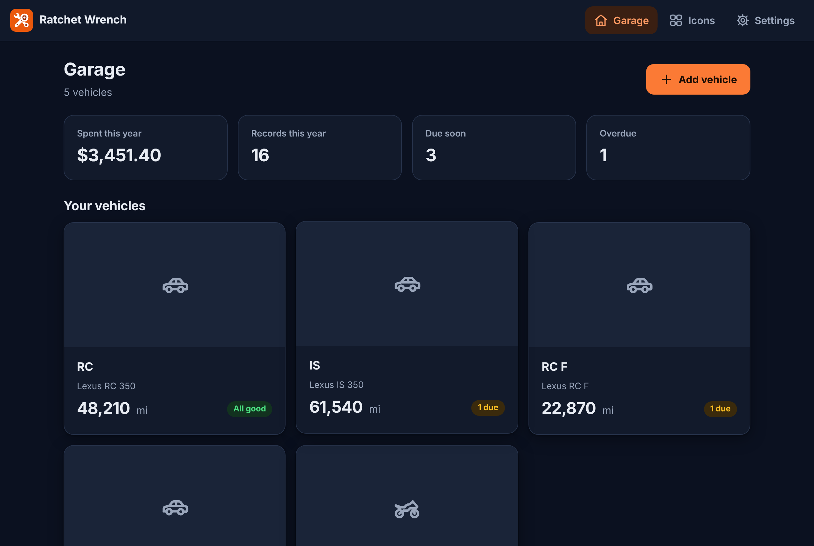
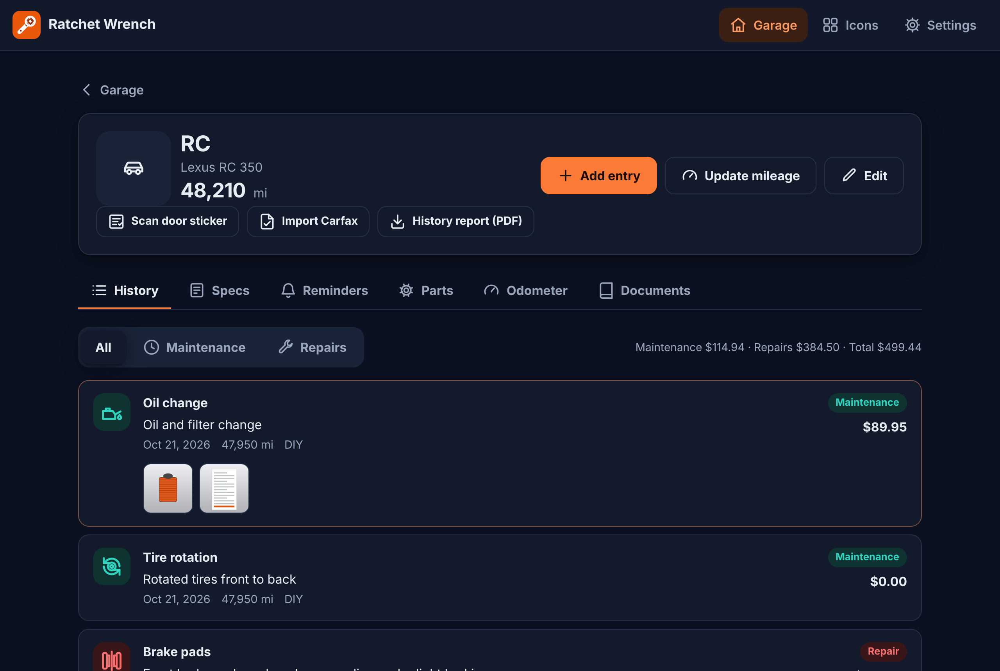
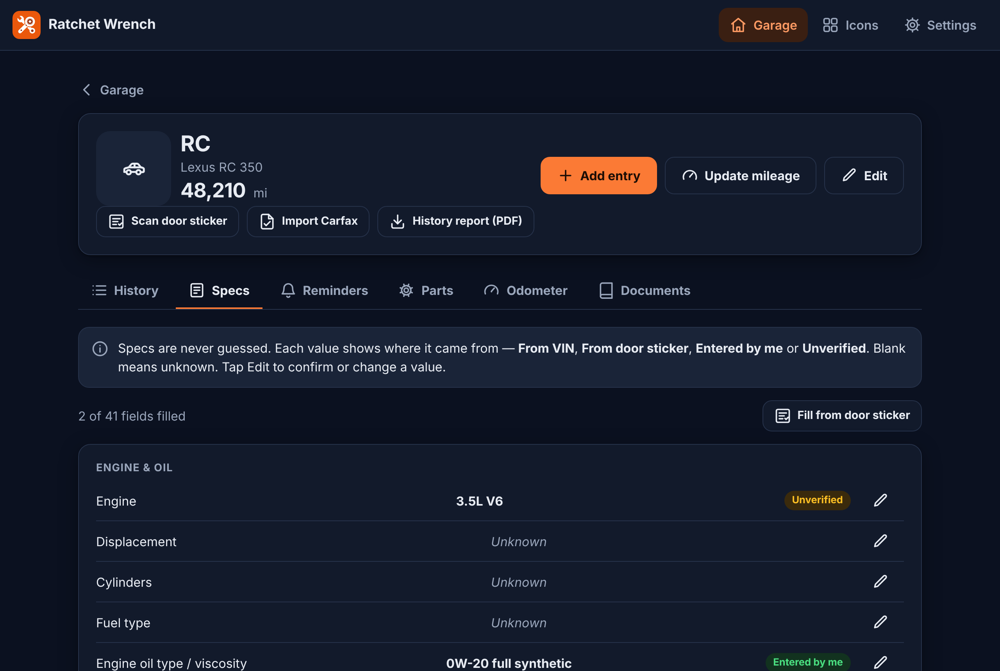
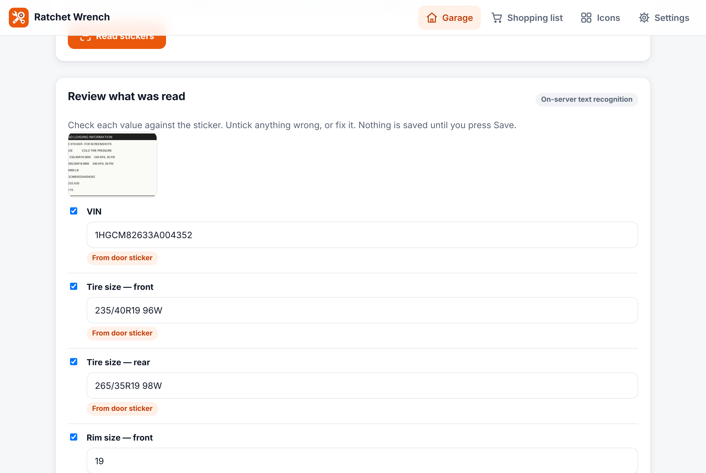
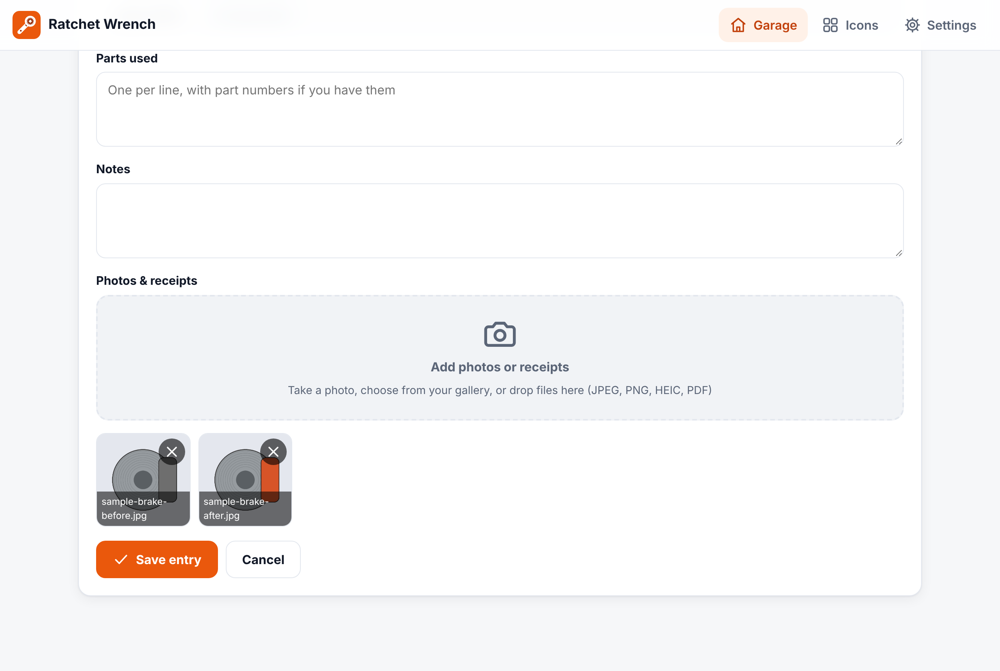
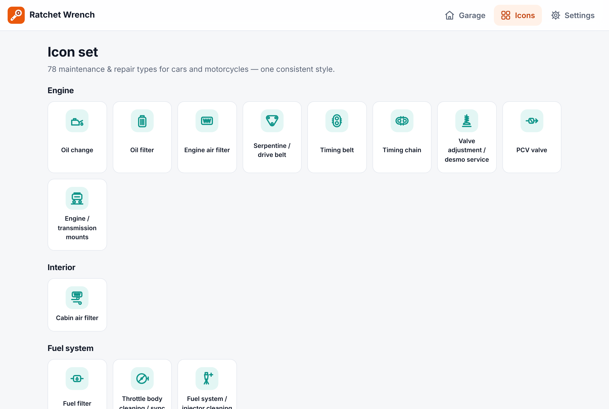
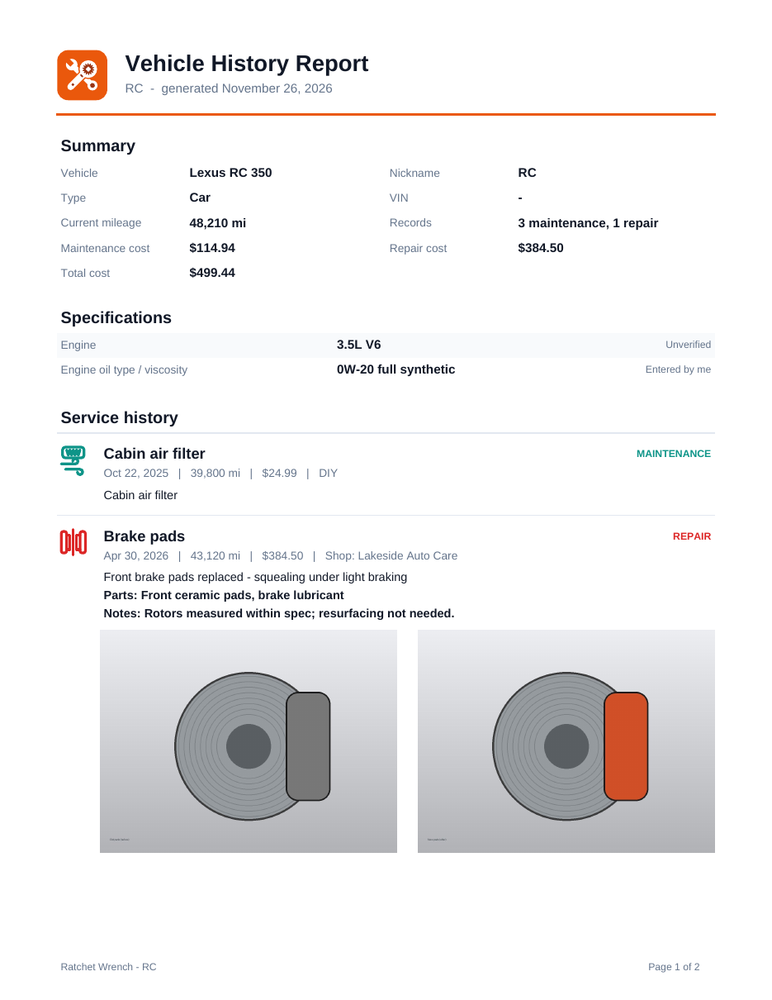
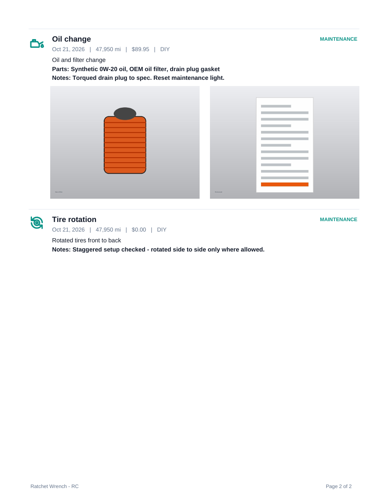

<p align="center">
  <picture>
    <source media="(prefers-color-scheme: dark)" srcset="brand/logo-dark.svg">
    
  </picture>
</p>

<p align="center"><strong>A private, self-hosted maintenance &amp; repair log for your cars and motorcycles.</strong></p>

---

## What it does

Ratchet Wrench keeps the complete history of your vehicles on **your own home server**: no accounts with outside companies, no ads, no tracking. You use it from a **web browser** or the **Android app**, which also works offline.

- **Vehicles:** cars and motorcycles with year, make, model, nickname, VIN, mileage and a photo.
- **VIN:** type it, or **scan the VIN barcode** with the phone camera. The free US government (NHTSA) decoder fills in what it knows.
- **Door-jamb sticker scan:** photograph the stickers inside the driver's door. The phone reads the text itself (offline) and finds the VIN, tire sizes, tire pressures, paint and trim codes, build date and weight ratings. You **confirm, edit or reject every value** before it is saved as "From door sticker". On the web, the server reads the photo instead.
- **Specs:** oil type and capacity, tire sizes and pressures, paint code, fluids and more. Every value shows where it came from: **From VIN**, **From door sticker**, **Entered by me** or **Unverified**. Nothing is ever guessed; unknown stays blank.
- **Maintenance and repair records**, kept clearly separate. Each has the date, mileage, type (with its own icon), description, parts, cost, shop or DIY, notes, and **any number of photos and receipts**.
- **Carfax import:** upload a Carfax PDF, review every record it found, and save the ones you approve.
- **Reminders** by mileage, by date, or **whichever comes first** (e.g. oil every 5,000 miles or 6 months).
- **Alerts:** phone notifications that work offline, plus optional push alerts through your own ntfy server. Never email.
- **Odometer history**, a **parts list** with OEM part numbers, and one-tap links to the **manufacturer's official parts site and owner portal**.
- **Owner's manual:** link to the owner portal, or upload the PDF.
- **History report PDF** with a summary, specs, every record in date order with icons, costs, totals and photos — from the web or the phone.
- **Light, Dark or System theme** in both apps.

## Screenshots

All screenshots were captured automatically from the running web app with the sample data (`tools/screenshots/run.sh`). The sticker and Carfax files are synthetic samples.

| | Light | Dark |
|---|---|---|
| **Garage dashboard** |  |  |
| **Vehicle page — history** |  |  |
| **Vehicle page — specs with source labels** |  |  |
| **Door-jamb sticker scan — review screen** |  |  |
| **Adding a repair with photos** |  |  |
| **Icon set (78 types)** |  |  |
| **Carfax import — review screen** |  |  |

**History report (PDF)**

| Page 1 | Page 2 |
|---|---|
|  |  |

> **Android screenshots:** the build machine couldn't run an Android emulator (no hardware virtualization), so there are no phone screenshots yet. The Android app has the same screens and colors. See [Installing the Android app](#installing-the-android-app).

---

## Running the server on your home server (Docker)

You need a computer that stays on (a home server, NAS or mini PC) with **Docker** and **Docker Compose** installed. On Linux, follow Docker's official guide: <https://docs.docker.com/engine/install/>.

1. **Download Ratchet Wrench.** Open a terminal on the server and run:
   ```bash
   git clone https://github.com/dannyspace21/Rachet-Wrench.git
   cd Rachet-Wrench
   ```
2. **Create your settings file:**
   ```bash
   cp .env.example .env
   nano .env
   ```
   - Set **`RW_ADMIN_PASSWORD`** to a long password you don't use anywhere else. This creates your first login.
   - Trying it on your home network without HTTPS first? Set `RW_COOKIE_SECURE=false` (switch it back once you add HTTPS).
   - Optional: `RW_SEED_SAMPLE_DATA=true` loads the sample vehicles so you can explore.
   - Save with **Ctrl+O**, Enter, then **Ctrl+X**.
3. **Start it:**
   ```bash
   docker compose up -d --build
   ```
   The first build takes a few minutes.
4. **Open it** in a browser on the same network: `http://SERVER-IP:8000`. Find the server's IP with `hostname -I`. Sign in as `admin` with your password.
5. **Set up HTTPS and remote access** — strongly recommended. Follow **[docs/HTTPS.md](docs/HTTPS.md)**; the easiest option is Tailscale. **Never forward port 8000 on your router.**

**Everyday commands** (run them in the `Rachet-Wrench` folder):

| What | Command |
|---|---|
| Stop | `docker compose down` |
| Update to the latest version | `git pull && docker compose up -d --build --pull always` |
| See the logs | `docker compose logs -f` |
| Back up everything | `docker run --rm -v ratchet-wrench_ratchet-data:/data -v "$PWD":/backup alpine tar czf /backup/ratchet-backup.tgz /data` |

Your database and photos live in the Docker volume `ratchet-data`. Back it up regularly.

**Extras**
- **Add family members:** *Settings → Users → Add user*. Each person sees only their own vehicles.
- **Browse the API documentation** (for tinkerers): *Settings → API documentation*. You must be logged in.
- **Optional AI vision for hard-to-read stickers:** set `RW_AI_VISION_ENABLED=true` and `RW_AI_VISION_API_KEY=…` (an Anthropic API key) in `.env`. This **sends sticker photos to a third party**; the app warns before every use.
- **A paid VIN-spec service** can be plugged in later (`RW_VIN_SPEC_PROVIDER`, `RW_VIN_SPEC_API_KEY`). See `server/app/vin.py`.

---

## Installing the Android app

The app needs **Android 10 or newer**.

**Recommended: install with automatic updates (Obtainium)**
1. Install **[Obtainium](https://github.com/ImranR98/Obtainium)**, a free, open-source app updater.
2. In Obtainium, tap **Add App**, paste `https://github.com/dannyspace21/Rachet-Wrench`, and tap **Add**, then **Install**.
3. That's it: every new version published on GitHub installs automatically.

Full instructions, including the one-time signing-key setup the owner does first, are in **[docs/ANDROID-UPDATES.md](docs/ANDROID-UPDATES.md)**.

**Signing in:** open **Ratchet Wrench** and enter:
- **Server address:** your HTTPS address, e.g. `https://garage.your-tailnet.ts.net`
- your username and password
- Only if you have no HTTPS yet: tick "Allow plain HTTP on my home network" and use `http://192.168.x.x:8000`.

When asked, allow **notifications** (for reminders) and the **camera** (the first time you scan).

**Alternatively, build it yourself:** open the `android` folder in Android Studio, or run `cd android && ./gradlew assembleRelease`. A build made on your own computer without the permanent key uses a temporary key and can't update an installed copy.

**How offline mode works:** everything you add on the phone is saved on the phone first. When you're online again, the app syncs with your server automatically (pull down on the Garage screen to sync right away). Photos upload in the background. Reminder notifications work with no connection at all.

---

## Setting up ntfy push alerts (optional)

[ntfy](https://ntfy.sh) is a small, free notification server you can run yourself. Ratchet Wrench uses it to push "oil change due" alerts to any device. The Android app already shows reminders offline without it.

1. **Start the included ntfy server:**
   ```bash
   docker compose --profile ntfy up -d
   ```
   It runs on port 8080. Put it behind Tailscale or HTTPS like the main app.
2. **Tell Ratchet Wrench where it is.** In `.env`, set:
   ```
   RW_NTFY_URL=http://ntfy:80
   ```
   (Use your own ntfy address instead if you already have one; add `RW_NTFY_TOKEN` if it requires login.) Restart with `docker compose up -d`.
3. **Choose a topic:** in the web app, go to *Settings → Push alerts*, tick the box, and pick a **hard-to-guess topic name**. Anyone who knows the topic can read it, so treat it like a password. Press **Save**, then **Send test**.
4. **Subscribe on your phone:** install the **ntfy** app, add your server's address, and subscribe to the same topic.

Ratchet Wrench checks reminders every hour and alerts you when one becomes *due soon* (within 500 miles or 30 days) or *overdue*, at most once every 3 days per reminder.

---

## Security

Security was the top priority. Highlights:
- **Logins and sessions:** Argon2id password hashing, account lockout and rate limiting, expiring login tokens.
- **Web protections:** strict security headers, closed CORS.
- **File uploads:** checked by their real content type, with GPS and other metadata stripped from photos, and untrusted PDFs read in a sandbox.
- **Server container:** runs as non-root with a read-only filesystem.
- **Android app:** the login token is encrypted with the Android Keystore, and HTTPS is enforced.
- **No telemetry or tracking.** There are only three documented outbound connections, and two are optional.

Every dependency is pinned and scanned with pip-audit, npm audit, OSV-Scanner, Trivy, Semgrep, Gitleaks, Android lint and CodeQL.

👉 **Read [SECURITY.md](SECURITY.md)** for the full list, the final scan results, known unfixed issues (with their risk and mitigations), and how to rerun the scans yourself.

---

## For the curious

| Folder | What's inside |
|---|---|
| `server/` | The API server (Python, FastAPI, SQLite) and its 57 automated tests |
| `web/` | The web app (plain HTML/CSS/JavaScript, no third-party libraries) |
| `android/` | The Android app (Kotlin, Jetpack Compose) |
| `catalog/` | The shared list of maintenance types, spec fields and manufacturer links |
| `icons/`, `brand/` | The icon set and logo, plus the scripts that draw them |
| `docs/` | HTTPS guide and screenshots |
| `scripts/security-scan.sh` | Runs every security scanner |
| [DECISIONS.md](DECISIONS.md) | Why each design choice was made |
| [PROGRESS.md](PROGRESS.md) | Build status and notes for future work |

All code is commented in plain English: every file starts with what it does, and every function explains what and why.
